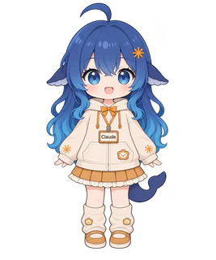

# 大肥鱼动画库 · Fat Fish Animations

为大肥鱼小屋制作的服装动画与扩展动作。这里收录我们新增的 AI 辅助二创素材，原来的基础动作仍由上游仓库提供；角色设计和参考服装不因此变成本项目原创。




## 首版内容

| 套装 | 稳定 ID | 动作数 |
| --- | --- | --- |
| 鲸鱼针织套装（试验） | `whale_knit` | 16 |
| 鲸鱼兜帽冬装 | `whale_hood` | 16 |
| 橙星奶油卫衣 | `cream_hoodie` | 16 |
| 蓝绒猫爪套装 | `cat_paw` | 16 |
| 浅蓝鲸鱼睡衣 | `whale_pajamas` | 16 |

另有经典女仆装的翻书、哼歌、吃白米饭、被摸头、开心转圈，共 **85 项动作条目**。有的动作共用同一张图集，条目数不等于独立图片数。哼歌只有画面，没有音频。

每套包括站立、左右走路、睡觉、醒来、喝饮料、吃鲷鱼烧、开心、难过、生气、困倦、读书、哼歌、吃饭、摸头、转圈。查看 [完整目录](catalog.json)。

## 播放预览

安装 Node.js 24 或更新版本。在仓库目录运行：

```sh
npm ci
npm run validate
npm test
npm run preview
```

打开终端打印的 `http://127.0.0.1:4175/`，选择服装、动作、速度，逐帧检查或重新播放。预览服务器只监听本机，不接 QQ、不读取聊天、不需要模型或任何账号。也可只运行 `npm run preview`，预览页本身不依赖 sharp。

## 接入小屋

下载本仓库，在本仓库目录执行：

```sh
node scripts/install-to-game.mjs whale_pajamas /path/to/fat-fish-companion/game
```

然后在小屋的 `game` 目录运行 `npm run build`，按原部署方式更新网页并在空闲时重载核心。安装器拒绝重复 ID，不会悄悄覆盖已有服装。已安装这些 ID 的现有小屋不需要再装一遍。

接入其他引擎、升级既有服装、女仆装扩展动作，见 [接入说明](docs/INTEGRATION.md)。支持矩形帧 `grid` 的加载器才能正确读取这些包，不能把整张图强行当作 256×256 方格。

## 添加新服装或动作

请先读 [制作与贡献规范](CONTRIBUTING.md) 和 [帧格式](docs/FORMAT.md)。保持角色参考一致，逐动作生成，检查透明背景、道具和脚底，再提交素材、清单、预览与来源说明。直接以这个仓库为基础提交 Pull Request 即可。

生成式图集仍可能有细微边缘、服装细节或帧间差异。格式检查通过只代表文件可读取，发布前还需要实际播放检查。

## 来源与使用范围

- 角色原设计：上善无形；女仆版二创：ZipZipPipe。
- 参考基础动画：[tndmgzo7/blue-fat-fish-desktop-pet](https://github.com/tndmgzo7/blue-fat-fish-desktop-pet)。本库不重新收录其整套基础动作。
- 本库新增图集通过内置 Image Gen 参考角色及用户提供的服装图制作、整理，不代表原作者制作或审核。
- 橙星奶油卫衣参考 Claude 娘服装；蓝绒猫爪套装参考用户指认的《怪物猎人》呆猫 COS。部分服装参考图作者待补充，设计权利归原权利人。
- **角色衍生素材遵循 CC BY-NC-SA 4.0 的署名、非商业和相同方式共享要求；预览及辅助代码采用 MIT。** 这些条款仅适用于本项目有权许可的贡献，不额外授予第三方角色、服装或商标的权利。

详细见 [署名](ATTRIBUTION.md)、[素材许可](LICENSE)、[代码许可](LICENSE-CODE) 和 [上游原许可说明](third_party/UPSTREAM_ASSET_LICENSE.txt)。本库不包含机器人账号、登录凭据、聊天、日记、旅行照片、运行日志、备份或模型文件。
